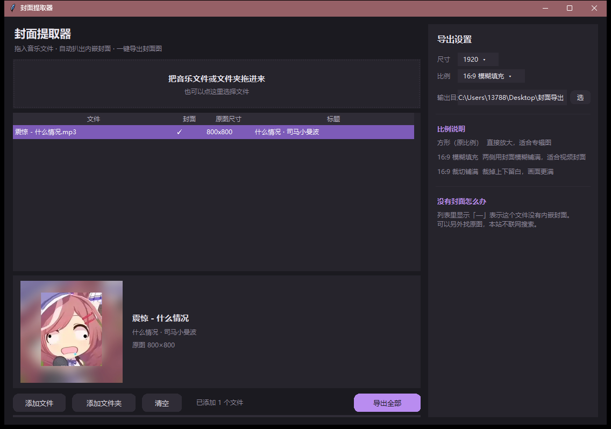

# CoverGrab · 封面提取器

从音乐文件里**扒出内嵌封面**，一键导出成专辑图或视频封面。

支持 MP3 / FLAC / M4A / OGG / WAV 等格式，批量处理，三种导出比例。
纯 Python + tkinter，不需要 GPU，Windows / Linux 都能跑。




## 功能

- **拖入即读**：把音乐文件或整个文件夹拖进窗口，自动扫描并提取封面
- **批量处理**：一次导入几百首，逐条显示「有无封面 / 原图尺寸 / 标题艺人」
- **三种导出比例**
  - 方形（原比例）— 适合专辑图、头像
  - 16:9 模糊填充 — 两侧用封面自身模糊铺满，适合视频封面
  - 16:9 裁切铺满 — 裁掉上下留白，画面更满
- **尺寸可选**：1000 / 1200 / 1600 / 1920 / 2560 / 3840
- **不联网**：全程本地处理，不上传任何文件


## 安装

### Windows

```bat
pip install -r requirements.txt
start.bat
```

### Linux

```bash
chmod +x run.sh install.sh
./install.sh      # 装 python3 / Pillow / mutagen / tk
./run.sh
```

Arch 手动装：

```bash
sudo pacman -S python python-pillow python-tk
pip install --user --break-system-packages mutagen tkinterdnd2
./run.sh
```

`tkinterdnd2` 只用于拖拽，装不上也能用「添加文件」按钮。


## 用法

1. 拖入音乐文件（或点「添加文件」「添加文件夹」）
2. 看列表：`✓` 表示有封面，`—` 表示这个文件没有内嵌封面
3. 选中一条，下方预览封面和标题
4. 右侧选**尺寸**和**比例**，选**输出目录**
5. 点「导出全部」

导出的文件名是 `<歌名>.jpg`，冲突时自动加 `_1`、`_2`。


## 支持的格式

| 格式 | 封面存储位置 |
|---|---|
| MP3 | ID3 `APIC` 帧 |
| FLAC | `PICTURE` 块 |
| M4A / MP4 | `covr` 原子 |
| OGG / OPUS | `METADATA_BLOCK_PICTURE` / APIC |
| WAV | 通常**没有**封面（列表显示 `—`） |

WAV 本身没有存封面的标准，所以拖 wav 进去多半是空的，这是正常的。


## 常见问题

**拖不进去**
需要 `tkinterdnd2`（Windows 上还会用 `windnd`）。装不上就用「添加文件」按钮，功能完全一样。

**列表里全是「—」**
这些文件确实没有内嵌封面。WAV 和部分流媒体下载的 MP3 会这样，需要另找原图。

**导出的图很糊**
封面原图只有 640×640 的话，放大到 1920 一定会软。可以先把原图换成分辨率更高的版本。

**Linux 上中文是方块**
装中文字体：`sudo pacman -S noto-fonts-cjk`


## 实现

```
cover_grab.py       界面（tkinter）+ 提取逻辑
platform_utils.py   跨平台：打开文件夹、字体族
ui_widgets.py       圆角按钮
```

提取用 `mutagen` 读标签，渲染用 `Pillow`。


## License

MIT
